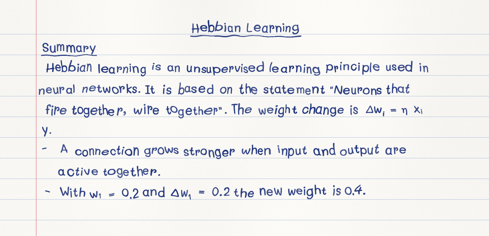

# word-file-to-handwritten

A Claude skill that turns a Word file, typed PDF, text file or pasted text into
a handwritten-looking PDF on plain or ruled paper.



Every letter is drawn separately with small random changes in size, tilt,
spacing and baseline, and each page is bent slightly, so no two letters are
identical. It needs no browser: only Python and a few libraries.

## Repository layout

```
skills/word-file-to-handwritten/   the skill itself
  SKILL.md                         instructions Claude reads
  scripts/handwrite.py             renderer (command line + Python class)
  assets/fonts/                    bundled fonts and their licences
examples/                          sample input and output
tools/                             helper scripts used by the workflows
.github/workflows/                 tests on every push, packaged skill on every release
```

## Install

**Claude Code**

```bash
git clone https://github.com/aritra0342/word-file-to-handwritten
cp -r word-file-to-handwritten/skills/word-file-to-handwritten ~/.claude/skills/
pip install -r word-file-to-handwritten/requirements.txt
```

**Claude.ai (web or desktop)**

Download `word-file-to-handwritten.skill` from the latest
[release](https://github.com/aritra0342/word-file-to-handwritten/releases) and
upload it under Settings > Capabilities > Skills. Code execution and file
creation must be turned on.

## Use

Ask Claude in plain words, for example:

- "Convert report.docx to handwritten on ruled paper in blue ink"
- "Write this text out as handwritten pages"
- "Make notes.pdf handwritten using my font myhand.ttf"

The script also runs on its own:

```bash
python skills/word-file-to-handwritten/scripts/handwrite.py report.docx -o report_handwritten.pdf --paper ruled --ink blue
```

Input can be `.docx`, `.pdf`, `.txt` or `.md`.

| Option | Meaning |
|---|---|
| `--paper plain\|ruled` | blank paper, or blue rules with a red margin line |
| `--ink black\|blue\|R,G,B` | pen colour |
| `--font path.ttf` | a different handwriting font, such as one made from your own writing |
| `--size N`, `--pitch N` | letter size and line spacing in pixels at 200 dpi (defaults 41 and 70) |
| `--messiness F` | 0 very neat, 1 natural (default), 1.5 hurried |
| `--frame` | pencil border round each page |
| `--keep-pages` | start a new page wherever the source PDF does |

Text files may use light markup: `# ` title, `## ` sub-heading, `- ` or `1)`
list items, `---` for a new page, and `_{..}` / `^{..}` for subscripts and
superscripts.

For maths, tables and exact layouts, `handwrite.py` has a small `Doc` class
(lines, wrapped paragraphs, columns, stacked fractions, boxed results).
`SKILL.md` documents it, and Claude uses it when plain text is not enough.

## Your own handwriting

The bundled font is a neat, round, upright print. It is a generic hand, not
yours. To write in your real handwriting, make a font from it (for example by
filling in a template on Calligraphr and downloading the `.ttf`) and pass it
with `--font`. A photo of a few handwritten sentences is not enough, because
most letters, digits and symbols will be missing.

## Limits

- From a Word file the script keeps headings, lists and paragraphs; each table
  row becomes one line, and images are skipped. Old `.doc` files must be saved
  as `.docx` first.
- Scanned or photographed PDFs have no text layer; transcribe them first.
- A character that the font does not contain is left out, so check unusual
  symbols against the source.
- The result is a picture of handwriting in a PDF. Printed, it is not pen ink
  on paper.
- Latin script only.

## Contributing

See [CONTRIBUTING.md](CONTRIBUTING.md). Changes are listed in
[CHANGELOG.md](CHANGELOG.md).

## Licence

Code: MIT (see `LICENSE`). Bundled fonts: SIL Open Font License 1.1.
